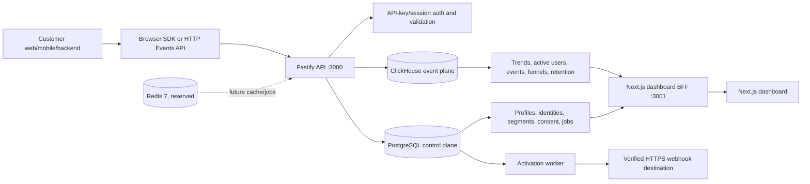

# CRM-DOPE

CRM-DOPE is a small, self-hostable, first-party customer data and product analytics platform for marketplaces and product teams that want control over their event data. It collects product events, stores control-plane entities in PostgreSQL, stores analytical events in ClickHouse, resolves anonymous-to-identified profiles, evaluates structured segments, and provides a Next.js dashboard.

It is inspired by the core workflows of Braze, CleverTap, MoEngage, and PostHog. It is intentionally smaller: it is not a full CDP, marketing automation suite, CRM, or replacement for those products.

## Contents

- [Current scope and verified features](#current-scope-and-verified-features)
- [Architecture](#architecture)
- [Repository structure](#repository-structure)
- [Clean local setup](#clean-local-setup)
- [Environment variables](#environment-variables)
- [API reference](#api-reference)
- [Browser SDK](#browser-sdk)
- [Analytics and segmentation](#analytics-and-segmentation)
- [Activation and security](#activation-and-security)
- [Synthetic data](#synthetic-data)
- [Testing and troubleshooting](#testing-and-troubleshooting)
- [Public testing and deployment](#public-testing-and-deployment)
- [Known limitations and roadmap](#known-limitations-and-roadmap)

## Current scope and verified features

The classifications below reflect the source tree, tests, and local database-backed checks. “Implemented” means there is working code; it does not automatically mean production-ready.

### Implemented and verified

- **Event ingestion:** `POST /v1/track` and `POST /v1/track/batch`, API-key authentication, Zod validation, tenant ownership checks, request limits, and ClickHouse persistence. Unit and integration tests cover the core path.
- **Event storage:** ClickHouse `events.analytics_events`, with `ReplacingMergeTree` migration and `FINAL` in analytical queries. Event IDs are preserved for deduplication checks.
- **Control plane:** tenants, workspaces, projects, environments, API keys, customer profiles, identity aliases, platform users, memberships, segments, webhook destinations, consent records, activation requests, delivery jobs, and attempts are PostgreSQL entities.
- **Platform authentication:** Argon2id password hashes, PostgreSQL sessions, login/me/logout routes, workspace memberships, roles, and owner protections. Dashboard authentication uses an HttpOnly `cdp_session` cookie through the Next.js BFF.
- **Browser SDK:** `packages/browser-sdk` supports `pk_` keys, consent opt-in/opt-out, anonymous IDs, tracking, identification, reset, batching, and manual flush. It is suitable for development and review; persistence and a full retry queue remain follow-ups.
- **Identity resolution:** `/v1/identify` creates anonymous and identified profiles and can merge an anonymous profile into an identified profile through `customer_identities` aliases.
- **Analytics:** trends, active users, event exploration, funnels, and retention are registered Fastify routes and are wired to real dashboard pages.
- **Segmentation:** structured segment definitions and CRUD APIs are implemented. Event occurrence/count/recency preview paths are functional in the local verification dataset. Profile-trait preview currently has a compiler limitation described below.
- **Dashboard:** landing page, login, overview, trends, active users, event explorer, funnels, retention, segments, segment detail, shared navigation, BFF proxy, loading states, error states, and empty states are implemented in `apps/dashboard`.
- **Activation foundations:** webhook destinations, encrypted secrets, consent records, bounded audience enumeration for supported profile-trait cases, durable activation/delivery records, HTTPS URL validation, HMAC signing, worker claims, and cancellation/status routes exist.

### Partial or limited

- **Identity analytics:** analytics use `COALESCE(user_id, anonymous_id)`. Historical anonymous events are not automatically rewritten after a later identity merge.
- **Browser SDK delivery:** the SDK sends batches and handles a failed fetch by dropping the batch; durable client persistence, exponential retry, and offline recovery are not complete.
- **Segmentation:** event conditions are evaluated through ClickHouse. The current profile-trait compiler emits a ClickHouse query containing an unsubstituted `{op}` placeholder and references `customer_profiles` from ClickHouse, while profiles live in PostgreSQL. Profile-trait preview therefore returns a 400 until that backend path is corrected.
- **Activation audience:** the activation path safely refuses unsupported or incompletely enumerable audiences. End-to-end activation should be treated as a backend foundation rather than a campaign product.
- **Dashboard BFF:** the dashboard exposes an allowlisted subset of control APIs. Profile, browser-key, destination, consent, and activation administration remain direct API capabilities rather than dashboard screens.
- **Redis:** Redis is started by Docker Compose but is currently reserved; sessions and analytics do not depend on it.

### Planned or not verified as complete

- Mobile SDKs.
- Campaign orchestration, triggers, scheduling UI, and messaging channels.
- Saved cohort queries and materialized segment membership.
- Full browser SDK durable retry/offline queue.
- Production container images and a maintained production Compose deployment.
- MFA, SSO/OAuth, email delivery, and a complete audit-management UI.

## Architecture



The API is a modular Fastify monolith. PostgreSQL is the consistency/control plane. ClickHouse is the event/analytics plane. Accepted events are written to ClickHouse; dashboard analytics do not synchronously write to multiple stores. The activation worker claims durable PostgreSQL delivery jobs with `FOR UPDATE SKIP LOCKED`.

## Repository structure

```text
.
├── apps/
│   ├── api/
│   │   ├── src/routes/              # health, auth, ingestion, analytics, profiles, segments, activation
│   │   ├── src/services/            # identity, analytics, segments, activation, authorization
│   │   ├── src/repositories/        # PostgreSQL and ClickHouse access
│   │   ├── src/auth/                # ingestion-key and platform-session auth
│   │   └── src/__tests__/           # unit, integration, and database-backed tests
│   └── dashboard/
│       ├── pages/                   # Next.js pages and server-side BFF routes
│       ├── components/layout/       # sidebar, topbar, AppShell
│       ├── lib/                     # API client and workspace state
│       └── styles/                  # global Tailwind/PostCSS stylesheet
├── packages/
│   ├── event-schema/                # shared Zod event contracts
│   └── browser-sdk/                 # consent-aware TypeScript browser SDK
├── migrations/
│   ├── postgres/                    # ordered control-plane migrations 001–011
│   └── clickhouse/                  # event table and session column
├── scripts/
│   ├── bootstrap-owner.sh           # existing-scope owner bootstrap
│   ├── bootstrap-demo.sh            # local synthetic-demo scope + owner
│   └── seed-synthetic.js            # safe, idempotent synthetic profiles/events
├── docs/                            # architecture, contracts, security, testing, deployment
├── docker-compose.yml               # local PostgreSQL, ClickHouse, Redis
├── .env.example                     # API configuration placeholders
└── package.json                     # npm workspace scripts
```

## Clean local setup

### Prerequisites

- Node.js 20 or newer. The repository uses **npm workspaces** and `package-lock.json`.
- Docker Desktop or Docker Engine with Compose.
- `curl`, `psql`, and `openssl` for the documented checks.
- At least 2 GB of free memory for PostgreSQL, ClickHouse, and Redis.

### Install and start infrastructure

From the repository root:

```bash
npm install
npm run db:up
npm run health
```

The development Compose file publishes PostgreSQL on `localhost:5433`, ClickHouse HTTP on `localhost:8123`, ClickHouse native protocol on `localhost:9000`, and Redis on `localhost:6379`. Do not publish these ports on a public host.

The Compose init directories apply migrations only when a database volume is first created. For an existing volume, apply the ordered files explicitly:

```bash
for file in migrations/postgres/*.sql; do
  docker compose exec -T postgres psql -U postgres -d cdp_crm -v ON_ERROR_STOP=1 -f - < "$file"
done

for file in migrations/clickhouse/*.sql; do
  docker compose exec -T clickhouse clickhouse-client --multiquery < "$file"
done

npm run health
curl http://localhost:8123/ping
```

The project does not currently have a migration-version table or migration runner; the ordered SQL files are the source of truth.

### Configure the API

```bash
cp .env.example .env
set -a
. ./.env
set +a
```

For activation development only, generate a 32-byte encryption key rather than using a repository value:

```bash
export WEBHOOK_ENCRYPTION_KEY="$(openssl rand -base64 24)"
```

Start the API in a separate terminal, from the repository root:

```bash
set -a; . ./.env; set +a
cd apps/api
npm run dev
```

The API listens on `http://localhost:3000`.

Verify liveness and readiness:

```bash
curl httpy
curl http://localhost:3000/ready
```

Expected responses are `{ "status": "ok" }` and `{ "status": "ready" }`.

### Bootstrap a local owner and demo scope

For a clean local demo, this command creates the deterministic synthetic tenant/workspace/project/environment if absent, then creates one OWNER. It never drops or truncates data and only creates the scope when `CRM_DOPE_DEMO_MODE=true`.

```bash
export CRM_DOPE_DEMO_MODE=true
export BOOTSTRAP_EMAIL="you@example.test"
export BOOTSTRAP_PASSWORD="choose-a-local-password-at-least-8-chars"
npm run bootstrap:demo
```

The default local scope is:

- Tenant: `f0eebc99-9c0b-4ef8-bb6d-6bb9bd380a11`
- Workspace: `ffffffff-1111-2222-3333-444444444444` (`fixture-ws`)
- Project: `aaaaaaaa-1111-2222-3333-444444444444`
- Environment: `bbbbbbbb-1111-2222-3333-444444444444` (`development`)

To bootstrap an existing scope without creating anything, use:

```bash
export BOOTSTRAP_TENANT_ID="<existing-tenant-uuid>"
export BOOTSTRAP_WORKSPACE_ID="<existing-workspace-uuid>"
export BOOTSTRAP_EMAIL="you@example.test"
export BOOTSTRAP_PASSWORD="choose-a-local-password-at-least-8-chars"
npm run bootstrap:owner
```

The scripts hash passwords with Argon2id and never print them. They refuse to replace an existing platform user's password.

### Seed real synthetic records

Keep the API running, then in another terminal:

```bash
export CRM_DOPE_DEMO_MODE=true
export DEMO_WORKSPACE_ID="ffffffff-1111-2222-3333-444444444444"
export DEMO_INGESTION_KEY="sk_demo_$(openssl rand -hex 20)"
export SYNTHETIC_SEED="crm-dope-demo-v1"
npm run seed:synthetic
```

The default dataset creates 32 fictitious identities and approximately 422 events across 30 days. It includes anonymous pre-login activity, identified profiles, profile traits, repeated activity, signup/product/cart/checkout/order events, and retention-return events. The supplied key is registered only for the selected development environment and is not printed by the seeder.

Use `--dry-run` to validate scope and the requested plan without writing profiles or events:

```bash
CRM_DOPE_DEMO_MODE=true DEMO_INGESTION_KEY="$DEMO_INGESTION_KEY" npm run seed:synthetic -- --dry-run
```

Use `SYNTHETIC_USERS` from 1–250 and `SYNTHETIC_DAYS` from 7–90 to adjust the dataset. Repeat the command with the same seed and key safely: profile identities are checked first and deterministic event IDs already present in ClickHouse are skipped. The seeder has a hard production refusal and requires the explicit `CRM_DOPE_DEMO_MODE=true` flag.

### Start the dashboard

Create a server-only BFF configuration in `apps/dashboard/.env.local`, or export the variable before starting Next.js:

```bash
printf 'API_BASE_URL=http://localhost:3000\n' > apps/dashboard/.env.local
cd apps/dashboard
npm run dev
```

Open `http://localhost:3001`, sign in with the bootstrapped platform user, and select the seeded workspace if it is not already selected. The dashboard login uses the `/api/auth/login` BFF route, which sets an HttpOnly cookie; browser JavaScript never receives the upstream bearer token.

For a production build:

```bash
cd apps/dashboard
npm run build
npm run start
```

### Start the activation worker

The worker is needed only to process activation delivery jobs:

```bash
set -a; . ../../.env; set +a
cd apps/api
npm run dev:worker
```

The worker requires a valid 32-byte `WEBHOOK_ENCRYPTION_KEY` to deliver encrypted destination secrets. It fails closed when the key is absent or invalid.

## Environment variables

### API and database

- `PORT` — API listen port; optional, default `3000`.
- `PG_HOST`, `PG_PORT`, `PG_USER`, `PG_PASSWORD`, `PG_DATABASE` — PostgreSQL connection; local defaults are `localhost`, `5433`, `postgres`, `password`, and `cdp_crm`. Replace all defaults outside isolated local Docker.
- `CLICKHOUSE_URL`, `CLICKHOUSE_USER`, `CLICKHOUSE_PASSWORD`, `CLICKHOUSE_DB` — ClickHouse connection; local defaults are `http://localhost:8123`, `default`, empty password, and `events`.
- `BODY_LIMIT_BYTES` — Fastify request body limit; default `1048576`.
- `RATE_LIMIT_MAX` — requests per `RATE_LIMIT_WINDOW_MS`; default `100`.
- `RATE_LIMIT_WINDOW_MS` — rate-limit window; default `60000`.
- `MAX_BATCH_SIZE` — ingestion batch limit; default `500`.

### Activation

- `WEBHOOK_ENCRYPTION_KEY` — required for destination secret encryption and worker delivery. It must be exactly 32 UTF-8 bytes. Generate it outside source control and store it in a secret manager in shared environments.
- `ACTIVATION_MAX_AUDIENCE` — hard audience cap; default in the local example is `1000`. Requests that cannot be safely fully enumerated are refused.

### Dashboard and synthetic tooling

- `API_BASE_URL` — server-side dashboard BFF upstream; local default is `http://localhost:3000`. Do not use `NEXT_PUBLIC_API_BASE_URL` for credentials or internal API configuration.
- `CRM_DOPE_DEMO_MODE` — explicit `true` gate required by demo bootstrap/seeding scripts.
- `DEMO_WORKSPACE_ID` — optional synthetic-seeder workspace; defaults to the local fixture workspace.
- `DEMO_INGESTION_KEY` — required synthetic-seeder input. It is a caller-supplied secret key and is never generated as a source default.
- `SYNTHETIC_SEED`, `SYNTHETIC_USERS`, `SYNTHETIC_DAYS` — optional deterministic dataset controls.
- `BOOTSTRAP_TENANT_ID`, `BOOTSTRAP_WORKSPACE_ID`, `BOOTSTRAP_EMAIL`, `BOOTSTRAP_PASSWORD` — owner bootstrap inputs. `BOOTSTRAP_PASSWORD` must not be committed, logged, or reused in public demos.

The repository's `.env.example` contains placeholders only. `.env`, `apps/dashboard/.env.local`, keys, passwords, session tokens, and encryption keys must remain untracked.

## API reference

All timestamps are ISO-8601 UTC values. Ingestion API keys authenticate customer application traffic. Platform sessions authenticate operators and are required for `/v1/control/*`. Never use one in place of the other.

### Health and authentication

- `GET /health` — unauthenticated liveness.
- `GET /ready` — unauthenticated ClickHouse readiness.
- `POST /v1/auth/login` — `{ email, password }` → `{ token, expiresAt }`. The dashboard's BFF consumes this token and stores it in an HttpOnly cookie.
- `GET /v1/auth/me` — platform Bearer session → user information.
- `POST /v1/auth/logout` — revokes the platform session.

### Ingestion and identity

`POST /v1/track` accepts one `AnalyticsEvent`. `POST /v1/track/batch` accepts `{ "batch": AnalyticsEvent[] }` up to `MAX_BATCH_SIZE`.

Example:

```bash
curl -X POST http://localhost:3000/v1/track \
  -H "Authorization: Bearer $DEMO_INGESTION_KEY" \
  -H 'Content-Type: application/json' \
  -d '{
    "tenantId": "f0eebc99-9c0b-4ef8-bb6d-6bb9bd380a11",
    "eventId": "11111111-2222-4333-8444-555555555555",
    "timestamp": "2026-10-10T12:00:00.000Z",
    "type": "track",
    "event": "product_viewed",
    "anonymousId": "visitor-example-1",
    "sessionId": "session-example-1",
    "properties": { "product_id": "product_7", "category": "books" },
    "context": { "library": { "name": "example", "version": "1.0.0" } }
  }'
```

The event schema requires `tenantId`, UUID `eventId`, `timestamp`, `event`, and a discriminated `type` of `track`, `identify`, or `page`. The API key determines the authoritative tenant; a mismatched body `tenantId` returns 403. Successful ingestion returns 202. The batch endpoint returns 202 with `processed`.

`POST /v1/identify` accepts `{ tenantId, anonymousId?, userId?, traits? }` with an ingestion key. It creates or updates customer profiles and can merge anonymous and identified identities. `GET /v1/control/profiles` and the profile detail/events/sessions routes require a platform session and a workspace query parameter.

### Analytics

All analytics routes require a platform session, `workspaceId`, and `member:read`. Tenant scope is derived from the workspace on the server.

- `GET /v1/control/analytics/trends?workspaceId&startDate&endDate&interval=hour|day&eventName?` → `{ trends: [{ time_bucket, event_count }] }`.
- `GET /v1/control/analytics/active-users?workspaceId&startDate&endDate&period=day|week|month` → `{ activeUsers: [{ time_bucket, unique_users }] }`.
- `GET /v1/control/analytics/events?workspaceId&startDate&endDate&limit&offset&eventName?` → `{ events: [...] }`.
- `POST /v1/control/analytics/funnels?workspaceId` with `{ startDate, endDate, steps: string[] }`, two to five steps → `{ funnel: [...] }`.
- `POST /v1/control/analytics/retention?workspaceId` with `{ startDate, endDate, entryEvent, returningEvent }` → `{ retention: [...] }`.

Funnels use a seven-day ClickHouse `windowFunnel` conversion window. Retention is daily and defines cohorts by the first entry event. Analytics count event identities, not guaranteed merged people.

### Workspace, keys, and segments

- `GET /v1/control/workspaces/:workspaceId/members`
- `POST /v1/control/invitations`, `POST /v1/control/invitations/accept`
- `PATCH/DELETE /v1/control/workspaces/:workspaceId/members/:membershipId`
- `POST /v1/control/browser-keys` with `{ tenantId, workspaceId, environmentId?, name?, allowedOrigins? }`; the raw `pk_` key is returned once.
- `GET/POST /v1/control/segments?workspaceId`
- `GET/PATCH/DELETE /v1/control/segments/:segmentId?workspaceId`
- `POST /v1/control/segments/:segmentId/preview?workspaceId`

Segment definitions are JSON only: `definition_version: 1`, `operator: AND|OR`, and one to twenty allowlisted conditions. Supported kinds are `profile_trait`, `event_occurrence`, `event_count`, and `recency`. Raw SQL is never accepted.

### Destinations, consent, and activation

- `POST/GET /v1/control/webhook-destinations?workspaceId`
- `GET/PATCH/DELETE /v1/control/webhook-destinations/:destinationId?workspaceId`
- `POST/GET /v1/control/consent?workspaceId` with `profileId`, `purpose`, and `status` (`granted` or `withdrawn`).
- `POST /v1/control/segments/:segmentId/activations?workspaceId` with `destinationId`, `purpose`, and optional `idempotency_key`.
- `GET /v1/control/activations/:activationId/status|jobs|attempts?workspaceId`
- `POST /v1/control/activations/:activationId/cancel?workspaceId`

The activation implementation is intentionally conservative: unsupported audience conditions can be refused rather than enumerated unsafely.

## Browser SDK

Build the SDK with:

```bash
cd packages/browser-sdk
npm run build
```

Example:

```ts
import { init } from '@cdp/browser-sdk';

const cdp = init({
  key: 'pk_test_<one-time-browser-key>',
  endpoint: 'https://api.example.test/v1/track/batch',
  consent: false,
});

cdp.optIn();
cdp.track({ event: 'product_viewed', properties: { product_id: 'product_7' } });
cdp.identify({ userId: 'customer-123', traits: { plan: 'pro' } });
cdp.flush();
// cdp.optOut(); cdp.reset(); cdp.destroy();
```

Consent is off by default. `optIn()` creates the anonymous ID; `optOut()` clears the in-memory queue and stops flushing. `reset()` clears the user and starts a new anonymous ID. Browser keys are publishable identifiers, not secrets, and can ingest events only. They cannot log into the dashboard or access control APIs.

The SDK sends the shared event shape to `/v1/track/batch`. The current implementation has an in-memory queue and fetch failure handling; durable local storage, offline replay, and a complete exponential retry queue are future work.

## Analytics and segmentation

The dashboard uses the BFF at `/api/proxy/*`; it does not use hardcoded normal-mode metrics. The overview, trends, active-users, events, funnels, and retention screens use the real API responses and show loading/error/empty states.

The analytics identity is `COALESCE(user_id, anonymous_id)`. If an anonymous visitor is later identified, the profile alias is stored in PostgreSQL, but historical ClickHouse rows retain their original identity fields. This is why dashboard counts should be interpreted as event identities rather than exact people.

The event-based segment preview path works against ClickHouse `FINAL` and returns a bounded sample. Profile-trait preview is currently not complete: the compiler needs a PostgreSQL-backed profile query and safe operator handling. The UI does not fabricate a success response for this limitation.

## Activation and security

Webhook destination secrets are generated and encrypted with AES-256-GCM using `WEBHOOK_ENCRYPTION_KEY`. Destinations require validated URLs; production delivery requires HTTPS and rejects loopback/private/link-local/multicast targets. Delivery signs the canonical body with HMAC-SHA256 and includes a stable delivery ID and timestamp.

Consent is purpose-scoped and default-deny. Consent is rechecked immediately before delivery and on retry. Activation requests and per-profile delivery jobs are durable PostgreSQL records. The worker claims work with row locks, uses bounded retry/backoff behavior, and preserves a stable delivery ID across retries. Delivery is at-least-once, so receivers must deduplicate by delivery ID.

The activation unit/integration suite covers URL validation, signing, consent, retries, concurrency, and durable job behavior. A complete production webhook receiver and campaign UI are not included. Never expose PostgreSQL, ClickHouse, Redis, Docker, or the worker administration surface to the public internet.

## Synthetic data

The repeatable workflow is documented in [`docs/LOCAL_TESTING.md`](docs/LOCAL_TESTING.md) and implemented by `scripts/seed-synthetic.js`.

It uses the real `/v1/identify` and `/v1/track/batch` paths. Profiles have fictitious IDs and traits such as `country`, `plan`, `purchase_count`, `email_domain`, and `lifecycle_stage`. Events include `signup_completed`, `page_viewed`, `product_viewed`, `item_added_to_cart`, `checkout_started`, and `order_completed`, with timestamps distributed across the selected range.

The seeder:

- requires `CRM_DOPE_DEMO_MODE=true` and an explicitly supplied `DEMO_INGESTION_KEY`;
- refuses production-like environment variables and production environments;
- never drops, truncates, or deletes data;
- validates the selected workspace/project/environment and refuses a production environment;
- uses deterministic IDs and checks ClickHouse before sending missing events;
- identifies profiles idempotently through the ingestion API;
- prints counts without printing credentials.

There is deliberately no destructive “reset synthetic data” command. Use a separate local database/Compose project for disposable experiments; repeated seeded runs are safe.

## Testing and troubleshooting

### Quality commands

From the repository root:

```bash
npm run typecheck
npm run lint
npm test
npm run build
```

The API and packages have TypeScript, ESLint, Jest, and build scripts. The dashboard has `typecheck`, `lint`, `build`, and `dev` scripts but no test script. Run dashboard checks directly when needed:

```bash
cd apps/dashboard
npm run typecheck
npm run lint
npm run build
```

Relevant API checks include:

```bash
cd apps/api
npm run typecheck
npm run lint
npm test -- --runInBand
npm run build
```

Integration tests need live PostgreSQL and ClickHouse. They must not be reported as passing when Docker is unavailable.

### Common failures

- **`/ready` returns 503:** run `npm run health`, inspect `docker compose ps`, and check ClickHouse logs with `docker compose logs clickhouse`.
- **Migrations appear missing:** Docker init scripts run only on a new volume. Apply the ordered migration files manually as shown above.
- **Dashboard redirects to login:** confirm API is on port 3000, `API_BASE_URL` is set for the Next server, and the platform user has a membership for the selected workspace.
- **Synthetic seeder refuses to run:** set `CRM_DOPE_DEMO_MODE=true`, provide `DEMO_INGESTION_KEY`, and do not set production environment markers.
- **Analytics are empty:** confirm the selected workspace is the same workspace bound to the ingestion key, wait for ClickHouse inserts, use a range covering the event timestamps, and query `/v1/control/analytics/events` directly.
- **Segment profile traits return 400:** this is the documented compiler limitation; event-based preview remains the verified path.
- **Activation delivery fails immediately:** confirm `WEBHOOK_ENCRYPTION_KEY` is exactly 32 bytes, destination URL policy passes, and consent is granted for the requested purpose.

## Public testing and deployment

### Temporary local sharing

The safe temporary topology is:

```text
tester browser --HTTPS tunnel--> Next dashboard/BFF :3001 --private localhost--> Fastify API :3000
                                                                  |--> private Docker services
```

Start and seed locally first. Start the dashboard with `API_BASE_URL=http://localhost:3000` in `apps/dashboard/.env.local`, then expose **only port 3001**:

```bash
cloudflared tunnel --url http://localhost:3001
```

Cloudflare Quick Tunnels produce a temporary `trycloudflare.com` URL for testing. See the official guide: <https://developers.cloudflare.com/tunnel/get-started/quick-tunnels/>. A Quick Tunnel URL is not an authentication system; share it only with intended testers, or use Cloudflare Access/a named tunnel when access restriction is required.

The BFF receives the public `Host` and same-origin `Origin`, so its mutation CSRF check continues to work. Do not disable origin checks. Do not tunnel ports 3000, 5433, 8123, 9000, 6379, Docker, or worker/admin surfaces. Stop `cloudflared` and revoke any temporary credentials when testing ends.

### Persistent public demo

No persistent public deployment is included or claimed by this repository. A safe deployment needs a separate VM or managed environment with:

1. A dedicated hostname and HTTPS reverse proxy (Caddy, Nginx, or a managed load balancer).
2. The dashboard and only intentionally public API routes behind the proxy; PostgreSQL, ClickHouse, Redis, and worker ports bound to a private network.
3. Persistent PostgreSQL and ClickHouse volumes plus tested backups. Redis can remain private and optional for the current code.
4. Secrets supplied through the host secret manager: database passwords, `WEBHOOK_ENCRYPTION_KEY`, and generated platform credentials. Never place them in Git or a public Compose file.
5. Migrations run as a controlled release step before the API/worker update.
6. An isolated demo tenant/database seeded only with synthetic data. Do not reuse customer data or the development database.
7. Firewall rules allowing only HTTPS ingress and controlled administrative access. Database host ports must not be internet reachable.
8. Health checks for `/health`, `/ready`, API logs, worker logs, database storage, and rollback/redeploy procedures.

The current repository has a development Compose file, not a maintained production Compose override or application Dockerfiles. Build and pin API/dashboard images or run the Node processes under a supervisor on the VM; do not treat `docker-compose.yml` with its published database ports as a production deployment. Docker's production Compose guidance is useful when adding that deployment packaging: <https://docs.docker.com/compose/how-tos/production/>.

Do not create a universal demo admin password. Bootstrap a generated/configured owner once for an isolated demo environment, or provide a least-privilege account through the existing role model.

## Known limitations and roadmap

- Fix the profile-trait segment compiler to join/query PostgreSQL profiles safely and parameterize operators correctly.
- Add a dashboard profile browser and browser-key management screens.
- Add durable browser SDK retry/offline storage and delivery observability.
- Add mobile SDKs and customer-backend integration examples.
- Complete campaign/trigger scheduling and one production-grade activation channel.
- Package production containers, private-network Compose configuration, backups, and deployment automation.
- Add MFA/SSO and a complete audit-log administration UI.

## Further documentation

- [`docs/ARCHITECTURE.md`](docs/ARCHITECTURE.md)
- [`docs/DATA_MODEL.md`](docs/DATA_MODEL.md)
- [`docs/EVENT_SCHEMA.md`](docs/EVENT_SCHEMA.md)
- [`docs/INGESTION.md`](docs/INGESTION.md)
- [`docs/USER_PROFILES.md`](docs/USER_PROFILES.md)
- [`docs/IDENTITY_RESOLUTION.md`](docs/IDENTITY_RESOLUTION.md)
- [`docs/ANALYTICS_SPEC.md`](docs/ANALYTICS_SPEC.md)
- [`docs/SEGMENTATION_SPEC.md`](docs/SEGMENTATION_SPEC.md)
- [`docs/ACTIVATION_SPEC.md`](docs/ACTIVATION_SPEC.md)
- [`docs/SECURITY_PRIVACY.md`](docs/SECURITY_PRIVACY.md)
- [`docs/AUTHENTICATION.md`](docs/AUTHENTICATION.md)
- [`docs/LOCAL_TESTING.md`](docs/LOCAL_TESTING.md)
- [`docs/DEMO_AND_DEPLOYMENT.md`](docs/DEMO_AND_DEPLOYMENT.md)

## License and contribution

CRM-DOPE is an early-stage open-source project. Review the repository license and [`docs/REVIEW_CHECKLIST.md`](docs/REVIEW_CHECKLIST.md) before contributing. Do not submit secrets, real customer data, generated build output, or database files.
